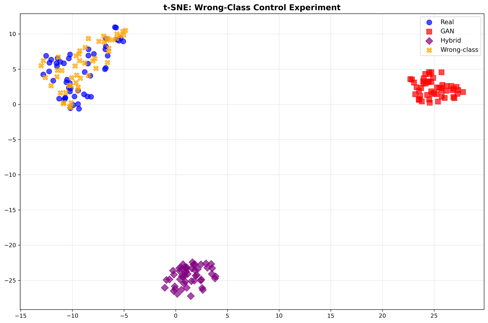
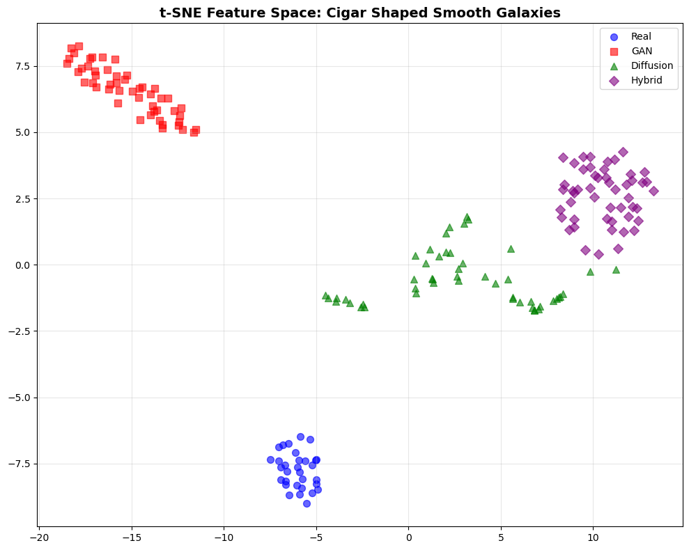
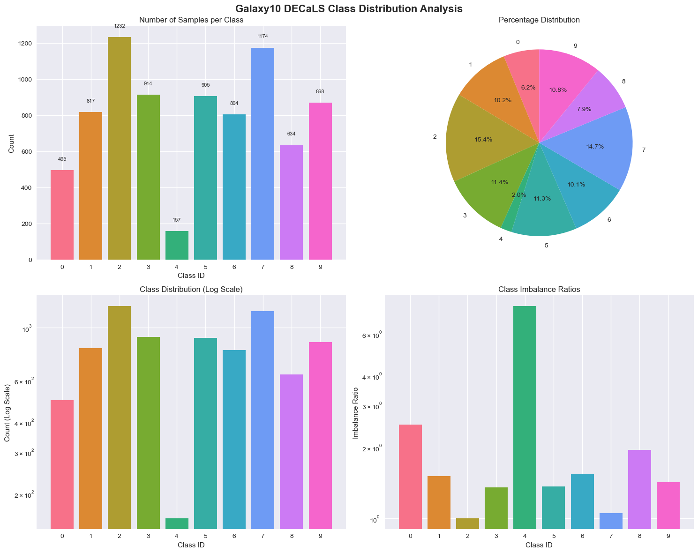
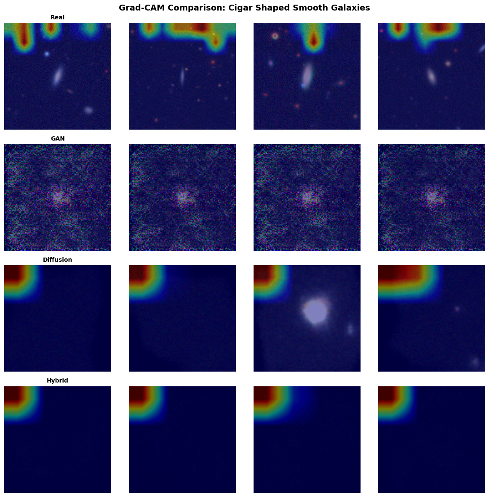

# Can Synthetic Galaxies Fix Class Imbalance?

**Generative data augmentation (DDPM, conditional GAN and a Diffusion-GAN hybrid) for galaxy morphology classification, tested with explainable AI.**

MSc Artificial Intelligence dissertation, University of Essex.

Rare galaxy types make up less than 2% of the Galaxy10 DECaLS dataset, so classifiers struggle to recognise them. A popular fix is to generate synthetic images of the rare classes with generative models. This project tests that idea properly: it builds three generative models, retrains a classifier with their images, and then uses explainable AI to check **whether the classifier actually learns galaxy shapes from synthetic data, or something else**.

  

---

## Key Findings

1. **Synthetic augmentation made the classifier worse, not better.** All three generative approaches lowered overall accuracy and the F1 score on rare classes. The rarest class (Cigar Shaped Smooth Galaxies) dropped by 5.2% with DDPM and cGAN, and by 13% with the Diffusion-GAN hybrid.
2. **The classifier treats synthetic galaxies as a different kind of data.** In the classifier's feature space, synthetic Merging galaxies sit **15 to 17 times further** from real Merging galaxies than real galaxies of a completely different class (Barred Spirals) do. See the limitations section for an important caveat on this measurement.
3. **Synthetic galaxies have the wrong brightness structure.** For Cigar Shaped galaxies, the centre-to-edge brightness ratio was 1.54 for real images but 1.24 to 1.85 for synthetic ones, a difference of around 20%.
4. **Visually plausible is not the same as scientifically valid.** Generated galaxies can look convincing to a person while missing the properties a classifier needs, so synthetic astronomical data should be validated with control experiments and XAI before use.

## Results

All models use the same DenseNet121 classifier and are evaluated on the same held-out test set of 1,600 images.

| Training data | Accuracy | Macro F1 | Rare-class F1 (avg of 4) | Cigar F1 | Merging F1 |
|---|---|---|---|---|---|
| **Real images only (baseline)** | **80.9%** | **0.780** | **0.832** | **0.712** | **0.819** |
| + DDPM synthetic images | 78.7% | 0.766 | 0.805 | 0.675 | 0.750 |
| + Conditional GAN synthetic images | 79.6% | 0.771 | 0.809 | 0.675 | 0.803 |
| + Diffusion-GAN hybrid images | 78.9% | 0.761 | 0.799 | 0.620 | 0.814 |

"Rare-class F1" is the average F1 over the four augmented minority classes: Merging (1), Cigar Shaped (4), Edge-on without Bulge (8) and Edge-on with Bulge (9).

<p align="center">
  
  
</p>

*Left: real Merging galaxies (blue) and real Barred Spirals (orange) overlap, while synthetic Merging galaxies from the GAN (red) and hybrid (purple) form separate clusters. Right: for Cigar Shaped galaxies, real images and each generator's images all occupy different regions.*

---

## Data

- **Dataset:** [Galaxy10 DECaLS](https://astronn.readthedocs.io/en/latest/galaxy10.html), 17,736 colour galaxy images (256x256) in 10 morphology classes.
- **Subset:** a stratified sample of 8,000 images, split 60/20/20 into 4,800 training, 1,600 validation and 1,600 test images.
- **Imbalance:** the rarest class, Cigar Shaped Smooth Galaxies, has only 157 images in the subset (2%), and just 94 in the training set.
- Images are resized to 128x128 for training.

The dataset is not included in this repository.

<p align="center">
  
</p>

## Method

### 1. Baseline classifier
- **DenseNet121** pretrained on ImageNet, with a new 10-class output layer.
- Trained for 25 epochs with Adam (learning rate 0.001, weight decay 1e-4), a step scheduler, batch size 8, and random flips and rotations.
- The checkpoint with the best validation accuracy is evaluated on the test set.

### 2. Generative models
Each model generates **200 synthetic images for each of the four minority classes** (800 images in total), which are added to the 4,800 real training images.

- **Conditional DDPM:** a U-Net with time and class embeddings, residual blocks, GroupNorm and SiLU activations, trained with a cosine noise schedule over 1,000 timesteps.
- **Conditional GAN:** a generator that maps a 100-dimensional noise vector plus a class embedding to a 128x128 image, and a convolutional discriminator with dropout. Trained for up to 200 epochs with a convergence-based stopping rule.
- **Diffusion-GAN hybrid:** the trained DDPM is frozen, and a timestep-aware discriminator is trained to tell its outputs from real images. During sampling, the discriminator's gradients steer every denoising step towards more realistic images.

### 3. Augmented classifiers
The baseline DenseNet121 is retrained from scratch on each augmented dataset with exactly the same settings, so any change in performance comes from the synthetic images.

### 4. Explainable AI and control experiment
- **Grad-CAM:** compares which image regions the classifier focuses on for real and synthetic galaxies.
- **Feature-space separation:** the distance between the average DenseNet features of real and synthetic images, scaled by the spread of the real features.
- **t-SNE:** 2D visualisation of the classifier's features for real and synthetic images.
- **Brightness profile:** the ratio of mean brightness in the centre of the image to the edges, a simple measure of galaxy structure.
- **Wrong-class control:** real Barred Spiral galaxies are compared against real Merging galaxies. If the classifier mainly cared about morphology, a different class should look far away. Instead it sits much closer than synthetic images of the *correct* class.

<p align="center">
  
</p>

---

## Limitations

These are the points I would address before treating the conclusions as settled:

- **Mismatched preprocessing in the XAI analysis.** In `08_xai_analysis.ipynb`, real test images are passed to the classifier at 256x256, while synthetic images are 128x128, and neither gets the ImageNet normalisation used during training. Part of the feature-space separation and the Grad-CAM differences may therefore come from image size and preprocessing rather than from synthetic artefacts. The fix is to resize and normalise all images identically and rerun the analysis. The classification results above are not affected, because the training and evaluation pipeline resizes and normalises every image the same way.
- **One training run per model.** Differences of 1 to 2 percentage points may fall within normal run-to-run variation. Repeating each experiment with several random seeds would show which differences are reliable.
- **Small, briefly trained generators.** The generators learned from very few examples (only 94 real Cigar Shaped training images), and the DDPM was trained for 20 epochs. Stronger generators might behave differently.
- **Subset of the data.** Only 8,000 of the 17,736 images were used, to fit the available compute.
- **DDPM version.** The DDPM classifier results come from an earlier generation run that targeted classes 0, 1, 4 and 7. The DDPM notebook in this repository generates classes 1, 4, 8 and 9, matching the other two models.

## Future Work

- Rerun the XAI analysis with identical preprocessing for real and synthetic images.
- Repeat all experiments with multiple random seeds and report confidence intervals.
- Measure generated image quality directly, for example with FID.
- Compare synthetic augmentation against simpler fixes for imbalance, such as class weighting or focal loss.
- Scale up to the full 17,736-image dataset.

---

## Repository Structure

```
galaxy-generative-augmentation/
├── 01_data_and_baseline.ipynb      # Data loading, class analysis, splits, DenseNet121 baseline
├── 02_ddpm_training.ipynb          # Conditional DDPM training and image generation
├── 03_cgan_training.ipynb          # Conditional GAN training and image generation
├── 04_diffusion_gan_hybrid.ipynb   # Discriminator-guided diffusion sampling
├── 05_classifier_ddpm.ipynb        # Classifier retrained with DDPM images
├── 06_classifier_cgan.ipynb        # Classifier retrained with cGAN images
├── 07_classifier_hybrid.ipynb      # Classifier retrained with hybrid images
├── 08_xai_analysis.ipynb           # Grad-CAM, t-SNE, feature separation, wrong-class control
├── results/                        # Metrics saved by each experiment (JSON)
├── figures/                        # Charts used in this README
└── requirements.txt
```

## How to Run

1. Clone the repository and install the dependencies:
   ```bash
   git clone https://github.com/Manas-Acharya/galaxy-generative-augmentation.git
   cd galaxy-generative-augmentation
   pip install -r requirements.txt
   ```
2. Download `Galaxy10_DECaLS.h5` from [astroNN](https://astronn.readthedocs.io/en/latest/galaxy10.html) and place it in `data/raw/`.
3. Run the notebooks in order, from `01` to `08`. Notebook `01` saves the processed train, validation and test splits to `data/processed/`, and each generative notebook saves its synthetic images to `results/`, where the later notebooks load them.

A CUDA GPU is strongly recommended. The experiments were run on a GPU with 17 GB of memory.

## Tech Stack

Python, PyTorch, torchvision, scikit-learn, NumPy, pandas, h5py, Matplotlib, seaborn

---

**Author:** Manas Acharya, MSc Artificial Intelligence (Distinction), University of Essex
Supervisor: Dr Jon Chamberlain
[LinkedIn](https://linkedin.com/in/manas-acharya-8m2a) · [GitHub](https://github.com/Manas-Acharya)
